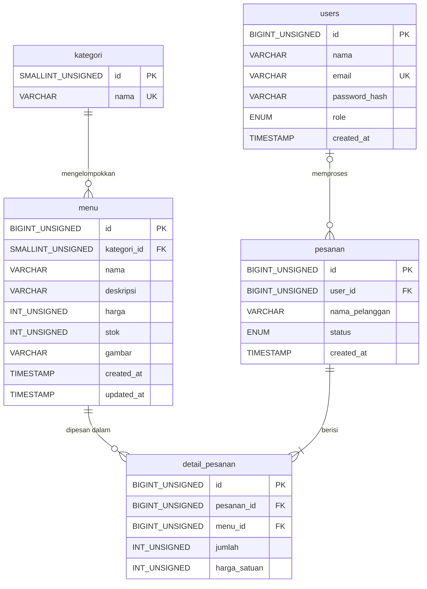

# ERD dan Data Dictionary - A2 Coffee and Food

## Data dictionary ringkas

| Tabel | Fungsi | Key dan constraint penting |
|---|---|---|
| users | Akun admin dan kasir | PK id; UNIQUE email; password disimpan sebagai hash |
| kategori | Pengelompokan menu (Minuman, Cemilan) | PK id; UNIQUE nama |
| menu | Daftar produk | PK id; FK kategori_id ke kategori(id); harga dan stok UNSIGNED; status diturunkan dari stok |
| pesanan | Header pesanan | PK id; FK user_id ke users(id) ON DELETE SET NULL; ENUM status |
| detail_pesanan | Item per pesanan | PK id; FK pesanan_id (ON DELETE CASCADE); FK menu_id; UNIQUE (pesanan_id, menu_id); harga_satuan menyimpan harga saat transaksi |

Alasan desain: kategori dipisah agar tidak ada teks berulang, total pesanan dihitung dengan SUM (tidak disimpan), dan harga_satuan disimpan agar riwayat tidak berubah saat harga menu diubah.